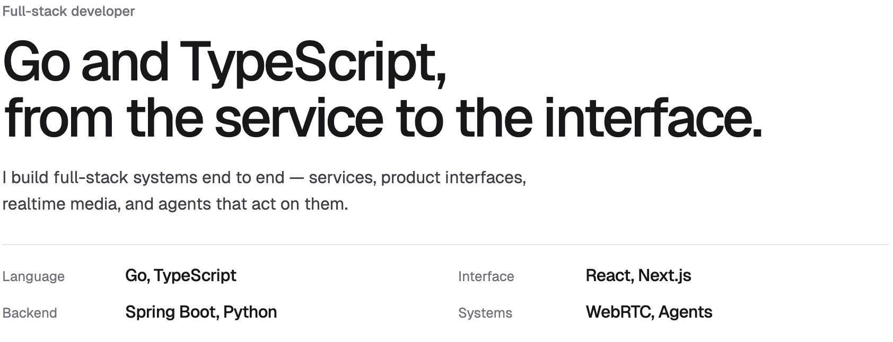

<picture>
  <source media="(max-width: 720px) and (prefers-color-scheme: dark)" srcset="assets/card-mobile-dark.png">
  <source media="(max-width: 720px)" srcset="assets/card-mobile-light.png">
  <source media="(prefers-color-scheme: dark)" srcset="assets/card-dark.png">
  
</picture>
