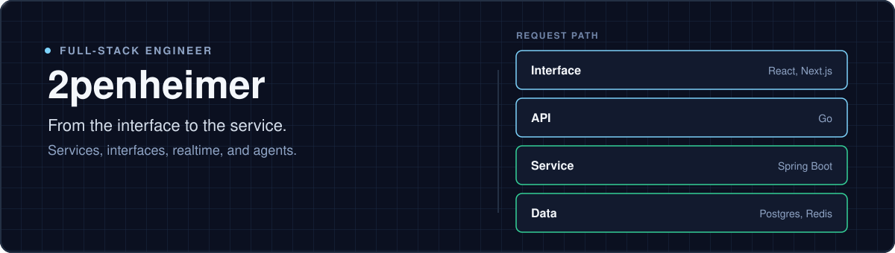

  

I build full-stack systems end to end — services, product interfaces, realtime media, and agents that act on them.

### Languages

  
  
  
  
  

### Frontend

  
  
  
  

### Backend

  
  
  

### Realtime

  
  
  

### Data

  
  
  
  

